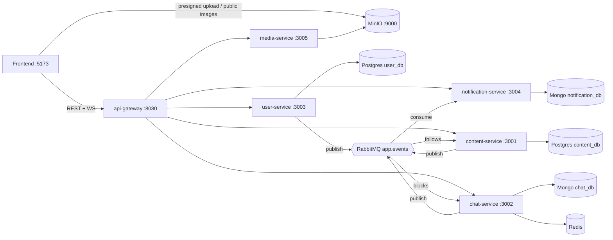

# SocialPulse

Social feed + real-time chat as microservices behind one API gateway.



## Run
```sh
cp .env.example .env && sh scripts/gen-keys.sh     # RS256 keypair -> .env
docker compose up --build -d
sh seed/seed.sh                                    # demo users, posts, follows, conversations; promotes "admin"
```
Seeded logins (password `password123`): `admin`, `alice`, `bob`, `carol`. Frontend: see `socialpulse/` (`npm i && npm run dev`, env `VITE_API_URL=http://localhost:8080`, `VITE_CHAT_URL=http://localhost:8080`, `VITE_NOTIFY_URL=http://localhost:8080`).

If port 8080 is taken on your machine, set `GATEWAY_PORT` and `PUBLIC_API_URL` in `.env`
(e.g. `8180` / `http://localhost:8180`) and rebuild the frontend so the UI points at it.
Postgres, MongoDB and Redis persist on named volumes, so `docker compose down` keeps your data
(use `down -v` when you want a clean slate).

## Ports
| Service | Port | Exposed |
|---|---|---|
| api-gateway | 8080 | yes |
| MinIO (browser uploads/reads) | 9000 | yes |
| user / content / chat / notification / media | 3003 / 3001 / 3002 / 3004 / 3005 | internal only |
| Postgres, Mongo, Redis, RabbitMQ (UI :15672) | 5432*, 27017, 6379, 5672 | dev only (*Postgres no longer published; use `docker compose exec postgres psql`) |

Swagger: every service at `/api/docs` on its own port (map a port temporarily to view).

## Events (exchange `app.events`, topic)
| Event | Producer | Consumers |
|---|---|---|
| user.registered | user | - |
| user.followed / user.unfollowed | user | content (follower visibility), notification (followed) |
| user.blocked / user.unblocked | user | chat |
| user.suspended / user.unsuspended | user | - |
| post.created / post.deleted | content | - |
| post.liked, post.shared, comment.created | content | notification |
| message.sent, conversation.created | chat | notification (message.sent) |

## Demo script
1. Log in as `alice`; create a post with `#sunset`. 2. As `bob`, like and comment; alice's notification bell updates live. 3. `carol` posts "followers" visibility: visible to alice (follows) but not to a new user. 4. Chat alice -> bob; typing/read receipts. 5. Report a post; as `admin` open `GET /admin/reports` and resolve with `remove`. 6. Block a user and confirm search hides them.

Contracts: [CONTRACTS.md](CONTRACTS.md). Status/assumptions: [PROGRESS.md](PROGRESS.md).
